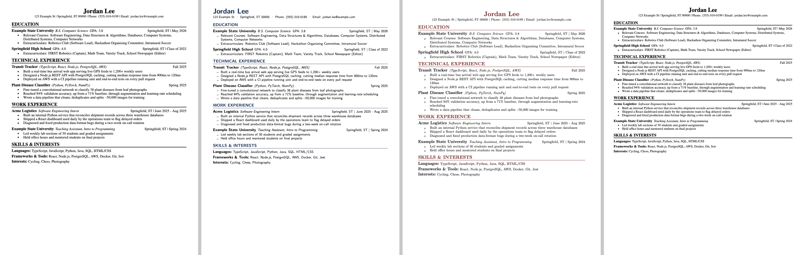

# Tailored LaTeX Resume

A one-page LaTeX resume system built for tailoring to each job. You write every
bullet once, group bullets into presets, and a short version file picks the
presets for a given role. You can also paste in a job description and
`build.py` has Claude pick the presets, then compiles the resume at the
loosest spacing that still fits on one page.


Everything in `content/` currently belongs to a fictional example person,
Jordan Lee. The first step is to swap in your own content.

---

## Set it up with AI (recommended)

If you already have a few versions of your resume (say, one for backend roles,
one for data roles and one for internships), an AI coding assistant can turn
them into this system for you. It keeps every wording from every version, so
nothing is lost.

1. **Get the repo.** Click **Use this template** → create a **private** repo,
   then clone it. (You can also clone or download the ZIP. Keep your copy
   private, since it will contain your personal details.)
2. **Install LaTeX.** On macOS run `brew install --cask basictex`. On Linux,
   run `sudo apt install texlive-latex-extra`. On Windows, install
   [MiKTeX](https://miktex.org). Or skip this step and use Overleaf (see below).
3. **Drop your resumes into `my_resumes/`.** PDF, DOCX, TXT or Markdown all
   work, and more versions are better. This folder is gitignored.
4. **Open the folder in an AI coding assistant** such as
   [Claude Code](https://claude.com/claude-code), Cursor or Copilot, and say:

   > Personalize this repo from the resumes in my_resumes/, following PERSONALIZE.md.

   It reads your resumes and asks about anything unclear, such as conflicting
   dates or which contact details to use. Then it rewrites `content/`, creates
   one version file per resume you gave it, and matches your old look in
   `style.tex`. At the end it compiles everything and reports back.
5. **Review what it flags.** Check any bullet marked `% AI-condensed ... review`
   (shorter versions it merged from your originals) and the section mapping.
   Everything else should be your own words.
6. **Build:** run `pdflatex <your-version>.tex`.

[`PERSONALIZE.md`](PERSONALIZE.md) is the step-by-step procedure the AI
follows. It's worth a skim so you know what to expect. `CLAUDE.md` and
`AGENTS.md` hold the standing rules AI assistants follow in this repo. The most
important one: when tailoring to a job, the AI may only **reorder, select and
trim** your existing bullets. It never invents new claims.

### Setting it up by hand

Follow the same steps as `PERSONALIZE.md` yourself. Edit `\Header` in
`content/education.tex`, then replace the entries in `content/*.tex` (see
[How the content is organized](#how-the-content-is-organized)). Update
`content/catalog.json` and point `example.tex` at your presets.

---

## Everyday use: tailoring to a job

**Option A: the builder script** (needs an [Anthropic API key](https://console.anthropic.com))

```bash
pip install -r requirements.txt
export ANTHROPIC_API_KEY=sk-ant-...
python3 build.py --clipboard      # after copying a job description
```

It prints the presets it chose, its reasoning, and any **gaps** (things the
posting asks for that aren't in your content). Then it builds the PDF and opens
it. Next it asks *"What would you change?"*. Answer in plain English (for
example "use the short version of Acme and put work above projects") and it
rebuilds. It saves each job, its first pick, its final pick and your feedback
to `memory.json`, and uses that history to make better first picks next time.
`memory.json` is gitignored.

| flag | effect |
|---|---|
| `-c`, `--clipboard` | read the JD from the clipboard (otherwise: argument, file path, stdin, or paste) |
| `-a`, `--autofill` | also build the parser-friendly version |
| `-s`, `--skills-early` | put skills directly under education |
| `--skills-late` | force skills last (overrides `-s`) |
| `--squeeze 0.85` | pin the spacing instead of searching for the loosest value that fits |

| environment variable | effect |
|---|---|
| `RESUME_MODEL` | which Claude model to use |
| `RESUME_TEX` | `xelatex` or `lualatex`, required if `style.tex` uses `\SetSystemFont` |

`build_advisory.py` works the same way and adds a **Suggestions** block. It
points out bullets or courses you've written that no preset uses yet but that
would suit this posting better.

**Option B: any AI assistant.** Open the repo, paste the job description, and
ask it to make a tailored version. `CLAUDE.md` keeps it to your existing
bullets.

**Option C: by hand.** Copy `template.tex`, uncomment the presets you want,
and compile.

---

## Changing the look

All formatting lives in **`style.tex`**. Content files never contain
formatting, so you can restyle without touching your wording. Start from one
of the ready-made looks and override whatever you like:


*Left to right: `classic` (the default), `modern`, `academic`, `compact`.*

```latex
% style.tex
\input{styles/modern}            % 1. pick a starting look

\SetAccentColor{0B6E4F}          % 2. then override anything
\SetPaper{a4}
\setlength{\zsBodySize}{10.5bp}  \setlength{\zsBodyLead}{11.8bp}
```

| setting | options |
|---|---|
| `\SetFont{...}` | `times` (default), `lmodern`, `lmodern-sans` work everywhere. `palatino`, `helvetica`, `bookman`, `newcentury` work on full TeX Live, MacTeX and Overleaf. If one isn't installed, the build falls back to Times and prints the `tlmgr install` command you need |
| `\SetSystemFont{Font Name}` | any font on your computer (Georgia, Garamond, Inter…). Needs the XeLaTeX compiler (`xelatex file.tex`, or `RESUME_TEX=xelatex` for `build.py`) |
| `\SetAccentColor{hex}` | color of your name, section headings and rules |
| `\SetHeaderAlign{...}` | `center` or `left` |
| `\SetBullet{...}` / `\SetBulletSize{...}` | e.g. `\textendash`, `$\circ$`, `\textasteriskcentered` |
| `\SetContactSeparator{...}` | what goes between contact fields, default ` \| ` |
| `\SetPaper{...}` | `letter` or `a4` |
| `\setlength{...}` | margins, every font size and its leading, rule thickness (`0bp` hides it), gaps between entries and sections, bullet indents |

[`styles/classic.tex`](styles/classic.tex) lists every setting with its
default value. To make your own look, copy it to `styles/yours.tex` and edit.

**Section titles** in hand-written version files are just
`\section{Whatever You Like}`. For resumes that `build.py` generates, rename
them under `section_headings` in `content/catalog.json`.

---

## How the content is organized

```
example.tex        a complete resume -- just a list of presets
skills_early.tex   same, with a grouped skills block under education
autofill.tex       plain layout for job-site resume parsers
template.tex       every preset, commented out -- copy this to start a version
style.tex          how it looks (font, color, sizes, margins, paper)
styles/            ready-made looks for style.tex

content/
  education.tex    \Header (your name/contact) + education
  technical.tex    projects / research
  work.tex         jobs
  skills.tex       skills blocks
  catalog.json     describes each preset for build.py

my_resumes/        your source resumes, for the AI to read (gitignored)
zsresume.cls       the layout engine; you shouldn't need to edit it
build.py           JD -> Claude picks presets -> fitted one-page PDF
PERSONALIZE.md     setup procedure, written for an AI assistant
```

`content/*.tex` has three tiers:

```latex
% TIER 3 -- individual bullets, one command each
\newcommand{\InternService}{\item Built an internal Python service that ...}
\newcommand{\InternServiceImpact}{\item Cut manual reconciliation work by ...}   % variant wording

% TIER 2 -- the entry header line
\newcommand{\InternEntry}{\entry{Acme Logistics}{Software Engineering Intern}{Springfield, ST | June 2025 - Aug 2025}}

% TIER 1 -- presets, built FROM the bullets
\newcommand{\InternShort}{\InternEntry\begin{bullets}\InternService\InternDashboard\end{bullets}}
```

A version file just lists presets:

```latex
\section{WORK EXPERIENCE}
\InternShort
\TA
```

When no preset fits, you can build the entry by hand:

```latex
\InternEntry
\begin{bullets}
  \InternServiceImpact
  \InternOnCall
\end{bullets}
```

Presets reference bullets rather than copying them, so editing a bullet once
updates every preset and version that uses it. **New wording goes in as a new
variant next to the old one**, so older versions keep building.

**`content/catalog.json`** is what `build.py` shows Claude: a one-line
description of each preset, plus your standing `selection_rules` (e.g. "always
include the internship"), the grouped/flat skills pairs and any
`section_headings`. `build.py` exits with an error if the catalog names a
preset that doesn't exist, and warns if a preset is missing from it.

## Fitting on one page

`\squeeze{0.85}` tightens the gaps *between* entries and sections, never the
line spacing inside a bullet. `1.0` is the default, `0.85` buys about two
lines, and below `0.6` it looks cramped. `build.py` finds the value for you.
It compiles at `1.0`, reads the page count, and steps down through `1.0, 0.90,
0.85, 0.80, 0.72, 0.62` until the resume fits. If it still doesn't fit, it
tells you, and you can ask for shorter presets.

## The autofill version

`\documentclass[autofill]{zsresume}` takes the same content and lays it out for
job-site resume parsers. Dates run inline, bullets are plain hyphens, there are
no rules, and everything is one font size. It also prints the `\linkedin{}` and
`\phoneplain{}` fields from `\Header`. Length is unconstrained, so make it
fuller than your real resume, and check what the site fills in.

## Overleaf

New Project → Upload Project → upload this folder as a zip. The compiler stays
on pdfLaTeX, or switch it to XeLaTeX if you use `\SetSystemFont`. Every font
listed above is installed on Overleaf.

## Notes

- Dimensions are in `bp` (1/72 in, the unit PDFs use), not LaTeX's `pt`.
  If you add spacing, write `12bp`.
- In content, escape `&` `%` `#` `_` `$` as `\&` `\%` `\#` `\_` `\$`. Helpers:
  `\sm` (~), `\arr` (→), `\x` (×), `\degsym` (°).
- The default font is Nimbus Roman (`mathptmx`), a free Times clone with the
  same character widths as Times New Roman.
